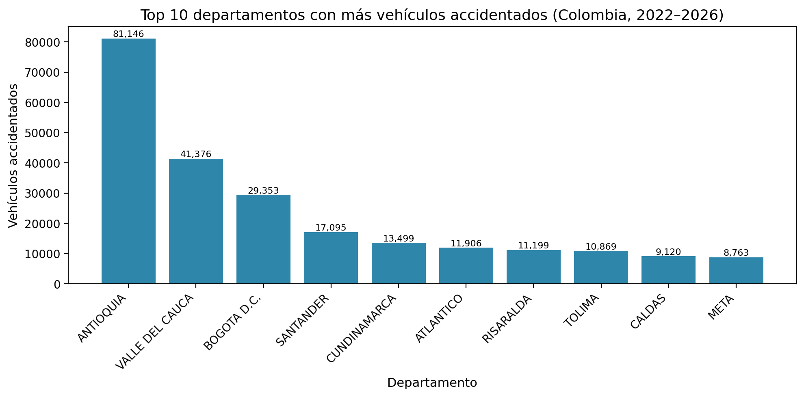
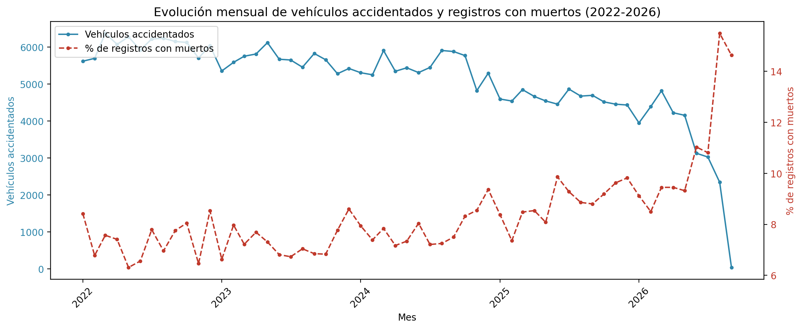
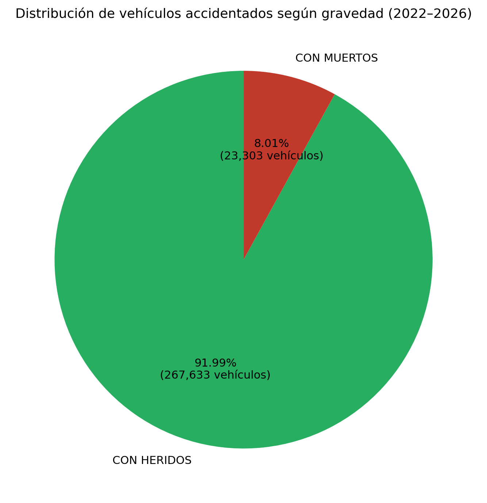
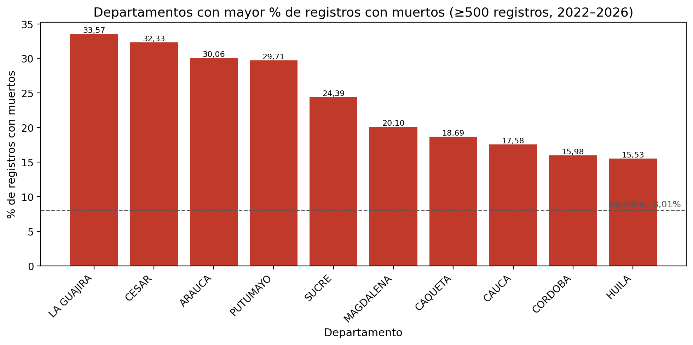
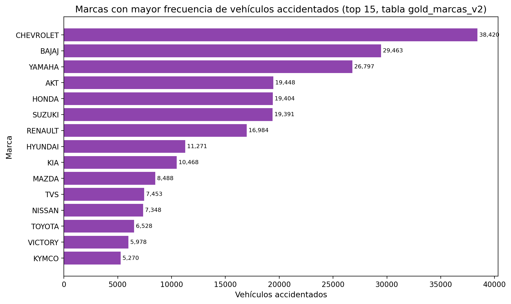
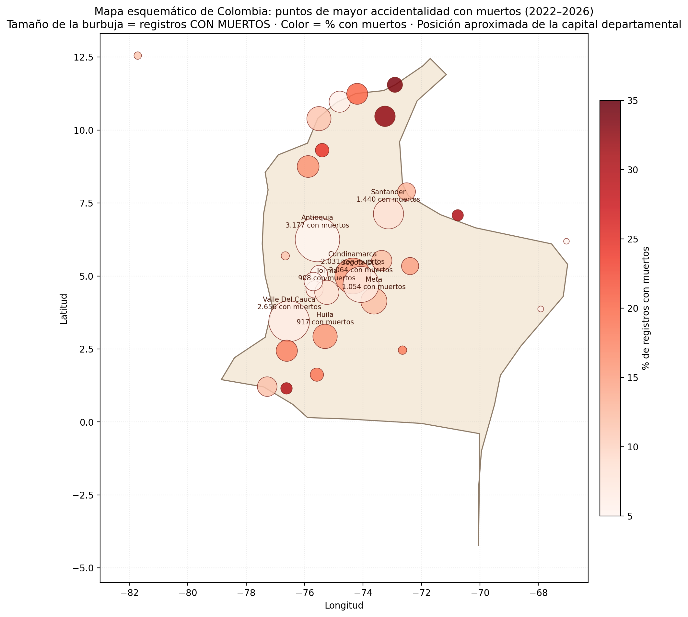

# Análisis de accidentalidad vial en Colombia con Databricks

**Proyecto Big Data**  
**Autoras:** Laura C. Arboleda y Ana M. Echeverri  
**Herramientas:** Databricks, PySpark, Delta Lake, Unity Catalog y Python.

## 1. Introducción y objetivo

En este proyecto desarrollamos un análisis de los registros de vehículos involucrados en accidentes de tránsito en Colombia. Nuestro propósito fue aprovechar las herramientas de Big Data para transformar una base de datos original en información organizada que permitiera identificar patrones de accidentalidad según la ubicación, el tiempo, las características de los vehículos y la gravedad de los registros.

Buscamos comprender cómo se comporta la accidentalidad registrada en el país y qué información podemos obtener para apoyar el análisis de la seguridad vial.

## 2. Desarrollo del proyecto: arquitectura Medallion

Para procesar la información utilizamos Databricks e implementamos la arquitectura Medallion, organizada en tres capas:

**Bronze – Ingesta de datos**

Cargamos el archivo CSV original mediante PySpark y lo almacenamos en formato Delta. Esta capa conservó los 450.335 registros iniciales, manteniendo la información original y su trazabilidad.

**Silver – Limpieza y transformación**

Realizamos un proceso de preparación y calidad de los datos. Estandarizamos textos, corregimos tipos de datos, transformamos las fechas, identificamos valores inconsistentes y eliminamos duplicados exactos.

Como resultado, obtuvimos 290.936 registros depurados. Los 159.399 registros repetidos fueron documentados mediante una tabla de auditoría, conservando la trazabilidad del proceso.

**Gold – Análisis de información**

Construimos tablas analíticas que permitieron estudiar la accidentalidad desde diferentes perspectivas: ubicación geográfica, evolución mensual, marcas, tipos de vehículos, antigüedad y gravedad de los registros.

Esta capa fue la base para realizar consultas, calcular indicadores y construir las visualizaciones del proyecto.

## 3. ¿Qué encontramos?

A partir de los análisis realizados identificamos varios patrones importantes:

- **Ubicación:** Antioquia concentra el 27,89 % de los registros, seguido por Valle del Cauca (14,22 %) y Bogotá D. C. (10,09 %).
- **Tipos de vehículos:** las motocicletas presentan la mayor participación, con 144.489 registros, aproximadamente el 49,7 % del total.
- **Gravedad:** el 91,99 % de los registros corresponde a vehículos involucrados en accidentes con heridos y el 8,01 % a accidentes con muertos.
- **Marcas:** Chevrolet presenta la mayor frecuencia, con 38.420 registros.
- **Comportamiento temporal:** observamos una disminución en la cantidad de registros entre 2022 y 2025, mientras que el porcentaje de registros con muertos aumentó del 7,38 % al 8,85 %.

También encontramos diferencias en la composición de la gravedad según el tipo de vehículo y el departamento. Esto permitió identificar patrones que no serían tan evidentes al observar únicamente los datos originales.

Es importante aclarar que cada registro representa un vehículo involucrado y no necesariamente un accidente individual. Asimismo, 2026 contiene información parcial hasta septiembre.

## 4. Visualización de resultados

Para facilitar la interpretación de los hallazgos desarrollamos siete visualizaciones en Databricks:

1. Departamentos con mayor cantidad de registros.
   ### Departamentos con mayor cantidad de registros

2. Evolución mensual de la accidentalidad.
   ### Evolución de la accidentalidad

3. Tipos de vehículos involucrados.
### Tipos de vehículos involucrados

4. Distribución según la gravedad.
   ### Distribución según la gravedad

5. Porcentaje de registros con muertos por departamento.
### Porcentaje de registros con muertos

6. Marcas de vehículos con mayor frecuencia.
### Marcas de vehículos

7. Distribución geográfica de los registros mediante un mapa esquemático.
### Distribución geográfica

Estas gráficas permiten comparar los resultados y comprender visualmente los patrones identificados durante el análisis.

## 5. Validación y resultados finales

Como parte del desarrollo, realizamos 17 comprobaciones de validación, todas satisfactorias. Verificamos la integridad de las tablas, la consistencia de los datos y la correspondencia entre las capas de procesamiento.

El resultado fue una arquitectura Medallion implementada en Databricks, con información depurada, tablas analíticas y visualizaciones que permiten explorar diferentes características de la accidentalidad vial.

## 6. Conclusión

Este proyecto nos permitió pasar de una base de datos sin procesar a información estructurada y útil para el análisis. Aprendimos a implementar un proceso de Big Data desde la ingesta y limpieza hasta el modelado y la visualización.

Principalmente, logramos identificar dónde se concentra la accidentalidad registrada, cuáles son los vehículos más involucrados, cómo se distribuye la gravedad y qué cambios se observan a través del tiempo. De esta manera, demostramos cómo el uso de Big Data facilita la comprensión de problemáticas reales y genera información que puede apoyar la toma de decisiones en materia de seguridad vial.
